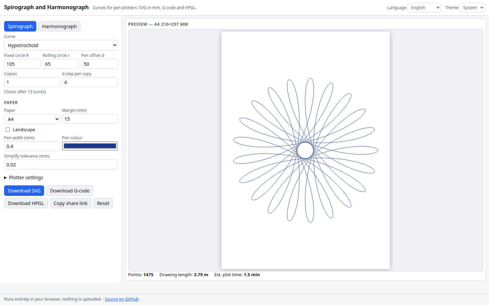

# Spirograph and Harmonograph

Generate spirograph (hypotrochoid and epitrochoid) and damped harmonograph curves sized in millimetres for pen plotters, and export SVG, G-code or HPGL.

**Try it: https://hermes98761234.github.io/spirograph-harmonograph/**

[](https://github.com/hermes98761234/spirograph-harmonograph/actions/workflows/deploy.yml)



## Features

- Hypotrochoids and epitrochoids with exact closing period (rational R/r), pen offset d, and multiple copies with a d step
- Damped harmonograph with four pendulums (frequency, phase, amplitude, damping), presets, duration and sample rate
- Paper sizes A5, A4, A3, Letter, 200 mm square, portrait or landscape, margins, automatic fit
- Ramer-Douglas-Peucker path simplification in mm
- SVG with real mm dimensions; G-code (Z-axis or servo pen, feeds, Y flip) and HPGL (40 units per mm)
- Drawing length and estimated plot time
- English and Ukrainian UI, light/dark/system theme, settings saved in the browser, shareable links
- Fully client-side: no backend, no tracking, your data never leaves the browser

## How it works

Curves are sampled as polylines, scaled uniformly to fit the paper minus the margin, centred, then simplified. The spirograph closes after q turns where R/r = p/q in lowest terms. The harmonograph is x(t) = sum A sin(2 pi f t + phase) e^(-d t) for two pendulums per axis.

## Quick start

```sh
npm install
npm run dev      # development server
npm test         # unit tests (vitest)
npm run lint     # oxlint
npm run build    # type-check and production build into dist/
```

## License

MIT, see [LICENSE](LICENSE).
